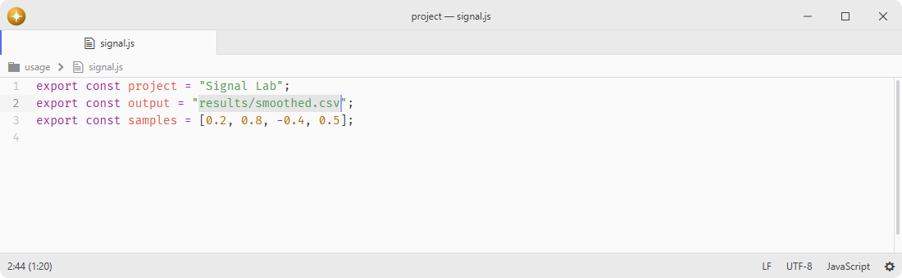

# super-select

Text selection helpers and slash normalization commands.

Selection commands read immutable source ranges in bounded blocks, including giant single lines and text beyond the native string limit. Long operations yield to the interface and discard pending work when the text, selections or package generation changes. Slash conversion streams exact edits and publishes large transformations atomically in one undo step; each selection keeps its independently inferred separator style. Character selection follows Unicode code points while preserving UTF-16 buffer coordinates. HTML selection uses a lexical tag scanner with quoted-attribute, comment and void-tag handling; it does not invoke a browser HTML parser.

## Features

- **String selection**: select text inside quotes.
- **Bracket selection**: select text inside brackets.
- **Character patterns**: select by custom character sets.
- **Slash normalization**: convert path separators to forward slash, backslash or double backslash.
- **HTML selection**: select HTML body or tags.

## Installation

To install `super-select` search for it in the Install pane of the Lumine settings, or run the command `lumine --install lumine-code/super-select`.

## Commands

Commands available in `lumine-text-editor`:

- `super-select:chars-1`: select text by chars `/[0-9\\p{L}_\\.]/`,
- `super-select:chars-2`: select text by chars `/[0-9\\p{L}_\\.\\-\\[\\]\\(\\)#]/`,
- `super-select:string`: select text inside `'''`, `"""`, `'`, `"` or backticks,
- `super-select:select-single-quoted-string`: select text inside `'''` or `'`,
- `super-select:select-triple-single-quoted-string`: select text inside `'''`,
- `super-select:select-backtick-string`: select text inside backticks,
- `super-select:select-double-quoted-string`: select text inside `"""` or `"`,
- `super-select:select-triple-double-quoted-string`: select text inside `"""`,
- `super-select:brackets`: select text inside `()`, `[]`, `{}` or `<>`,
- `super-select:select-parentheses`: select text inside `()`,
- `super-select:select-square-brackets`: select text inside `[]`,
- `super-select:select-curly-braces`: select text inside `{}`,
- `super-select:select-angle-brackets`: select text inside `<>`,
- `super-select:html-body`: select html body,
- `super-select:html-tags`: select html tags.

Commands available in `lumine-text-editor:not([readonly])`:

- `super-select:normalize`: convert slashes to match the leftmost separator in each selection,
- `super-select:double-backslash`: convert slashes to `\\` inside selection,
- `super-select:backslash`: convert slashes to `\` inside selection,
- `super-select:forward-slash`: convert slashes to `/` inside selection.

Normalize treats each selected path independently. The explicit slash-conversion commands use the requested style for every selection. Empty selections and text without separators are left unchanged, and one undo restores the whole operation.

## Contributing

Got ideas to make this package better, found a bug, or want to help add new features? Just drop your thoughts on GitHub. Any feedback is welcome!
